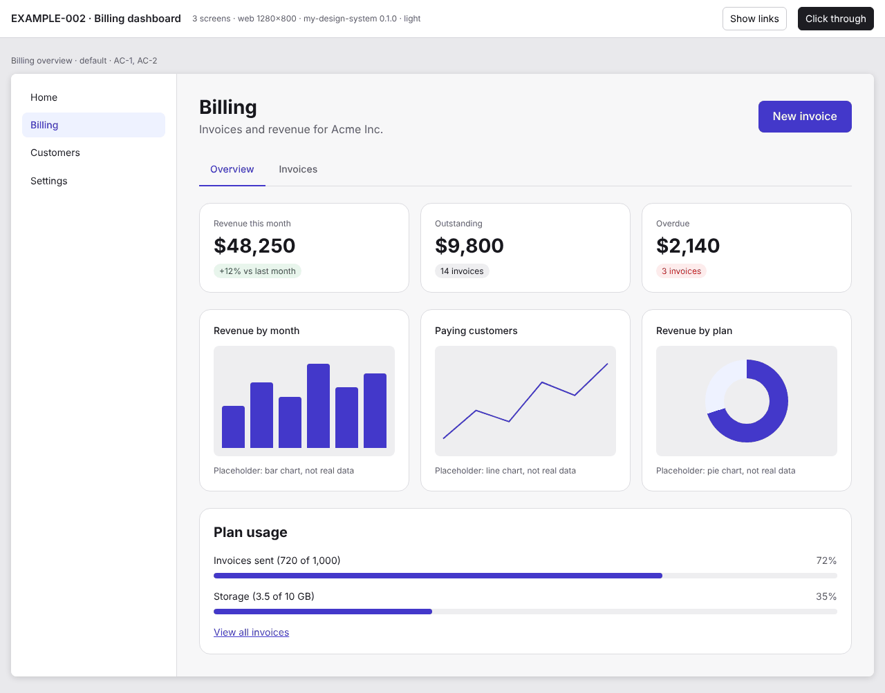

# SDD Kit: маркетплейс плагінів Claude Code для spec-driven розробки

[English](README.md) · Перевірено з Claude Code 2.1.301

Чотири плагіни, які працюють разом або окремо. Кожна фіча проходить шлях від ідеї до draft pull request. Спершу пишеться специфікація з діаграмою «як це працює», потім план і, за бажанням, клікабельний прототип на вашій дизайн-системі з розкладкою у Figma. Після цього йде код за TDD з рев'ю. Специфікацію і план погоджує людина, і merge теж робить тільки людина.

| Плагін | Що робить | Команди |
|---|---|---|
| **sdd-kit** | Оркестратор і агенти: discovery, analyst, architect, implementer, reviewer, branch-reviewer, verifier, security-auditor, debugger | `/sdd-kit:sdd`, `/sdd-kit:sdd-status`, `/sdd-kit:init-project` |
| **sdd-diagrams** | Перевіряє Mermaid у специфікації. Рендерить редакційні SVG, багатосторінковий `.drawio` і галерею для рев'ю | `/sdd-diagrams:feature-diagrams` |
| **sdd-design** | Агент ux-designer, `screens.json`, клікабельний HTML-прототип і стартер дизайн-системи | `/sdd-design:prototype`, `/sdd-design:design-system-init` |
| **sdd-figma** | Розкладає діаграми й екрани у Figma: через MCP-конектор або через локальний Figma-плагін | `/sdd-figma:figma-export` |

## Встановлення

```text
/plugin marketplace add HomeProgrammer1/sdd-kit
/plugin install sdd-kit@sdd-marketplace
/plugin install sdd-diagrams@sdd-marketplace     # рекомендовано
/plugin install sdd-design@sdd-marketplace       # якщо потрібні прототипи
/plugin install sdd-figma@sdd-marketplace        # якщо потрібна Figma
```

Те саме з терміналу: `claude plugin marketplace add HomeProgrammer1/sdd-kit`, потім `claude plugin install <name>@sdd-marketplace`. Плагіни не залежать один від одного. `sdd-kit` сам використовує інші, якщо вони встановлені.

Після встановлення `sdd-kit` Claude Code може показати «userConfig options not yet set». Це нормально, бо діють значення за замовчуванням: `guard_mode = sdd` і `format_on_edit = true`. Змінні середовища `SDD_GUARD=strict|hard-only|off` і `SDD_FORMAT=off` їх перевизначають.

Потрібні `bash` і Python 3.8+. Підійде будь-яка з команд `python3`, `python` або `py` на Windows. Якщо Python не знайдено, сесія стартує з попередженням, що guard вимкнений. У режимі `strict` дії в такому разі блокуються.

Далі в репозиторії проєкту:

```text
/sdd-kit:init-project                          # шаблон CLAUDE.md, правила, settings, specs/
/sdd-kit:sdd "Скидання пароля через email"     # зупиниться після специфікації (Gate 1)
/sdd-kit:sdd F-001 --level=plan --design --figma
/sdd-kit:sdd "Fix: посилання скидання спливає зарано" --quick   # дрібна правка, одні ворота
```

## Як це працює

```
/sdd-kit:sdd "опис" [--level=spec|plan|implement|push] [--quick] [--design] [--figma]
   0. discovery         коротке інтерв'ю, одне питання за раз → discovery.md
   1. analyst           spec.md: EARS-вимоги, AC-1..n (Given/When/Then), розділ «How it works» з Mermaid
      sdd-diagrams      перевірка і рендер діаграм → specs/F-001/diagrams/
   ═══ GATE 1: людина погоджує специфікацію ═══
   2. architect         plan.md, tasks.md (задачі з кроками), ADR
      sdd-design        ux-designer → design/screens.json → клікабельний прототип   (--design)
      sdd-figma         діаграми й екрани у Figma                                    (--figma)
   ═══ GATE 2: людина погоджує план (і прототип) ═══
   3. worktree + зелений baseline, pre-flight скан задач
   4. для кожної задачі: implementer (TDD) → reviewer (SPEC: PASS|FAIL, QUALITY: APPROVE|REQUEST_CHANGES)
      → до 5 раундів виправлень → коміт
   5. branch-reviewer → verifier (e2e проти AC) → security-auditor
   6. handover: push гілки і DRAFT PR
   ═══ GATE 3: review і merge робить ТІЛЬКИ людина ═══
```

Агенти передають одне одному **файли**, а не розмову. Кожен повертає фіксований блок (`STATUS`, `SPEC`, `QUALITY`, `VERDICT`), і оркестратор маршрутизує за ним. Стан прогону лежить у `specs/<ID>/state.json` і `ledger.md`, де рішення записано у форматі «Ruling: що — чому — ціна помилки». Тому роботу можна продовжити в новій сесії або після стиснення контексту.

**Швидкий режим.** `--quick` призначений для правки, яка відповідає всім умовам:
- зачіпає не більше 3 файлів;
- не додає екран, API, схему чи залежність;
- не стосується auth, платежів, прав доступу і секретів.

У цьому режимі немає discovery, architect і branch review. Security-аудит запускається лише тоді, коли диф зачіпає ці зони. Погодження потрібне одне, а не два. Щойно правка виходить за межі, прогін сам переходить у повний режим.

## Скільки коштує прогін

Це оцінка, а не вимір. Припущення для одного запуску агента:
- 30 ходів і в середньому 60 тис. токенів контексту;
- 90% входу читається з кешу, виходу 20 тис. токенів;
- Opus 5.5 коштує $4 за вхід і $20 за вихід на 1 млн токенів (читання кешу $0,20), Sonnet 5.5 коштує $2 і $10.

| | Запуски агентів | Оцінка |
|---|---|---|
| Повний режим, один раунд виправлень | 10 на Opus, 6 на Sonnet, оркестратор | ≈ $32 за фічу |
| Швидкий режим | 3 на Sonnet, оркестратор | ≈ $4–6 за правку |
| Та сама фіча в одній звичайній сесії | 1 | ≈ $5 |

Повний режим дає незалежне рев'ю, перевірку і security-аудит. Коштує він у кілька разів більше за звичайну сесію. Для дрібних правок використовуйте `--quick`. На підписці різниця проявляється в лімітах, а не в доларах.

## Діаграми: у кожної фічі є схема роботи

Аналітик пише діаграми в `spec.md` на **Mermaid**:
- Flow потрібен завжди;
- Sequence потрібен, якщо взаємодіють дві чи більше систем;
- State потрібен, якщо сутність має життєвий цикл.

Mermaid лишається єдиним джерелом: GitHub показує його в PR, а диф читається як текст. Щоб просто бачити діаграми, цей плагін не потрібен. Він додає перевірки й експорт. Перевіряються такі правила:
- не більше 12 вузлів, комфортно до 9;
- у кожного рішення підписані всі виходи;
- не більше двох акцентів;
- немає перекриттів і підписів на лініях.

Після перевірки генеруються файли:
- SVG у редакційному стилі: ортогональні лінії із заокругленням, підписи поруч із сегментом, AC-теги на вузлах, доступний `<title>/<desc>`, хеш джерела;
- `.drawio` з окремою сторінкою на кожну діаграму;
- `index.html`, галерея для рев'ю.

Кольори беруться з токенів вашої дизайн-системи (`--tokens`), з перевіркою контрасту WCAG AA. Рушій написаний на чистому Python, без мережі та залежностей.

<p align="center"></p>

## Дизайн: спершу власна дизайн-система

> **Важливо.** Щоб будувати дизайн і прототипи, спочатку **створіть власну дизайн-систему**. `sdd-design` не вигадує компонентів і кольорів. Він збирає екрани лише з того, що оголошено у вашій системі, тому прототип збігається з тим, що ви реально випустите. Без дизайн-системи команда зупиняється і пояснює, що робити. Прапорець `--sketch` дає лише сірий одноразовий ескіз.

**Окреме репо чи все в одному?** Рекомендую **один окремий репозиторій дизайн-системи** (монорепо), відокремлений і від продуктів, і від цього плагіна. Усередині лежать:
- спільні семантичні токени (DTCG), які є контрактом для коду, прототипів і Figma;
- **теми** (бренди, dark mode), які лише перенаправляють аліаси;
- **кіти**: `saas-dashboard`, `marketing-site`, `mobile-app`. Це підмножини компонентів, а не форки.

Розділяти на кілька репозиторіїв варто лише тоді, коли бренд веде інша команда з власним циклом релізів. Навіть тоді імена семантичних токенів мають бути спільними.

Як підключити:
1. Запустіть у новій порожній папці `/sdd-design:design-system-init`. Команда створить токени (primitives, light, dark), `components.json` з кітами, README і CHANGELOG, а також перевірить контраст.
2. Опублікуйте систему як окремий репозиторій із тегами версій (`v0.1.0`).
3. Підключіть її в продукт (наприклад, git submodule у `design-system/`) і вкажіть у `CLAUDE.md`:
   ```
   - Design system: design-system/components.json
   - Theme: light
   - Kit: saas-dashboard
   ```
4. Запустіть `/sdd-kit:sdd F-001 --design` або `/sdd-design:prototype F-001`.

Агент **ux-designer** створює `specs/<ID>/design/screens.json`. Це окремий екран для кожного стану (default, empty, loading, error, success), складений із компонентів вашої системи. На кожному екрані є AC-ID, а сам файл позначено хешем специфікації, з якої його зроблено. Рендерер робить із цього клікабельний `index.html`. У стартовій дизайн-системі 26 компонентів, серед них Table, Modal, Tabs, Pagination, Progress і заглушка Chart. Кіти беруть із них підмножини, а поруч із прикладом скидання пароля лежить приклад дашборду. Перевірки ловлять:
- невідомі компоненти й варіанти;
- биті посилання і недосяжні екрани;
- AC без екрана;
- контраст токенів нижче AA;
- `screens.json`, зібраний зі старої версії специфікації.

<p align="center"></p>
<p align="center"></p>

## Figma

`screens.json` і SVG-діаграми складаються в один `figma/bundle.json` разом із хешами файлів, з яких їх зроблено. Далі є два шляхи, і обидва дають однаковий результат:
- сторінка `<ID> · How it works` з діаграмами;
- сторінка `<ID> · Screens`, де кожен екран є фреймом з **auto layout**. Шари названо за компонентами, кольори і відступи прив'язано до **Figma variables** з ваших токенів, а між екранами стоять prototype-посилання.

На кожній сторінці є підпис із хешем специфікації і датою генерації.

| Шлях | Коли | Як |
|---|---|---|
| **MCP-конектор Figma** | Конектор підключено, ви дали URL файлу | Агент пише у ваш файл і, де можливо, ставить інстанси з вашої бібліотеки |
| **Плагін SDD Kit Import** | Без конектора або офлайн | Figma desktop → Plugins → Development → Import plugin from manifest → `.sdd/figma-plugin/manifest.json`, потім Build з `bundle.json` |

Якщо в `components.json` вказано ключі опублікованих компонентів бібліотеки, плагін ставить **справжні інстанси**. Інакше він малює компонент із токенів. Повторний запуск нічого не видаляє: попередні згенеровані шари переїжджають на сторінку `<ID> · Archive`, тож правки дизайнера в них зберігаються. Figma тут «нижче за течією»: зміни з Figma повертаються через `screens.json` або специфікацію.

## Сумісність з іншими плагінами

Kit не забирає собі сесію і нічого не блокує в чужій роботі. Його можна ставити поруч із загальними колекціями скілів (наприклад, superpowers) чи плагінами діаграм (наприклад, diagram-design).

**Guard має два рівні.**
- Жорсткі заборони діють завжди:
  - рекурсивне видалення кореня, домашньої теки чи теки проєкту. Блокується за будь-якого написання прапорців, усередині `bash -c` і в однорядниках на кшталт `shutil.rmtree('/')`;
  - force push у main/master і видалення цих гілок;
  - запис у `.git/`, `~/.ssh` і хмарні облікові дані.
- Процесні рейки діють лише в роботі самого kit: в агентах `sdd-kit:*` і `sdd-design:*` та в сесії, яка веде `/sdd-kit:sdd`. Вони охоплюють:
  - merge і approve, зокрема через API;
  - deploy, publish і теги;
  - `.env`, force push і обмеження ролей.
- Режими: `sdd` (за замовчуванням), `strict`, `hard-only`, `off`.

**Прогін, який загубив сесію, лишається захищеним.** Якщо у відкритого прогону не записано session id, рейки діють для всіх сесій цього проєкту, доки прогін не відновлять або не закриють. Повідомлення про відмову це прямо пояснює. `/sdd-kit:sdd` перевіряє це на старті, а `/sdd-kit:sdd-status` показує.

**Решта правил сумісності:**
- автоформатування після редагування працює лише в SDD-прогонах;
- на старті сесії немає примусових інструкцій, SessionStart лише показує відкриті прогони, якщо вони є;
- скіли мають вузькі описи («у прогоні sdd-kit…») і префікс `sdd-kit:`. Якщо поруч стоїть superpowers, його TDD-, debugging- і review-скіли працюють поза прогоном. Усередині прогону агенти kit беруть скіли `sdd-kit:`, бо оркестратор розбирає саме їхній формат звіту;
- залежностей від інших плагінів чи маркетплейсів немає.

## Безпека: три шари

| Шар | Механізм | Що гарантує |
|---|---|---|
| 1. Інструменту немає | `tools:` в агентах, `permissions.deny`, allow/deny-списки в сніпетах MCP | Reviewer фізично не може редагувати файли; агент не бачить інструменту merge |
| 2. Хук-заборона | `hooks/guard.py` на кожен Bash/Write/Edit, два рівні | Див. вище; analyst, architect і ux-designer пишуть лише в `specs/` і `docs/` |
| 3. Політика в тексті | скіл `autonomy-contract` | Рівні автономії, бюджети ретраїв, умови обов'язкової паузи |

Рівня `merge`, `release` чи `deploy` немає: ці кроки завжди робить людина.

## Що в репозиторії

```
.claude-plugin/marketplace.json      каталог із 4 плагінів
plugins/sdd-kit/                     8 агентів, 18 скілів, хуки, шаблон проєкту, output style
plugins/sdd-diagrams/                скіл feature-diagrams, рушій sdd_diagrams.py, style.md
plugins/sdd-design/                  агент ux-designer, скіли prototype і design-system-init (стартер)
plugins/sdd-figma/                   скіл figma-export, build_bundle.py, figma-plugin/ (manifest, code.js, ui.html)
scripts/validate.py                  JSON, frontmatter, кейси guard, діаграми, прототипи, тест Figma-плагіна
scripts/typecheck_figma.sh           перевірка Figma-плагіна за офіційними типами API Figma
.github/workflows/validate.yml       запускає все це і `claude plugin validate` на кожен push
THIRD_PARTY_NOTICES.md               звідки взято ідеї (MIT)
```

## Обмеження

- Повний цикл `/sdd-kit:sdd` на реальному проєкті ще не прогнано. Маніфести проходять `claude plugin validate`, тестове встановлення і `scripts/validate.py`.
- Figma-плагін перевірено тестом із суворим mock API Figma і за офіційними типами Figma, але в самій Figma його ще не запускали. Шлях через MCP-конектор описано, але на реальному файлі не перевірено.
- Рушій діаграм підтримує переносну підмножину: flowchart, stateDiagram-v2, sequenceDiagram. ER, class і gantt лишаються в Mermaid і рендеряться GitHub.
- Guard читає команди так, як їх написано, зокрема тіло `bash -c`. Він не бачить скриптів, які запускає команда, і рядків, зібраних під час виконання (змінні, base64, завантажений код).
- Згадку в лапках, наприклад `echo "rm -rf /"`, guard сприймає як саму команду.
- У режимі `sdd` помилка всередині guard пропускає дію, а `strict` її блокує.
- Адреси і пакети MCP-серверів у сніпетах можуть змінитися. Звіряйте їх із документацією вендора.

## Розробка

```bash
python3 scripts/validate.py
claude plugin validate .
for p in plugins/*; do claude plugin validate "$p"; done
npm install --no-save --ignore-scripts --prefix /tmp/figma-types typescript@6 @figma/plugin-typings
bash scripts/typecheck_figma.sh /tmp/figma-types/node_modules
```

Змінюючи плагін, піднімайте `version` у його `plugin.json` і в `marketplace.json`. Інакше користувачі не отримають оновлення.

## Подяки і ліцензія

Частина процедур переосмислює ідеї з [obra/superpowers](https://github.com/obra/superpowers) (MIT, © Jesse Vincent) і [diagram-design](https://github.com/cathrynlavery/diagram-design) (MIT, © Cathryn Lavery). Код не скопійовано, деталі в [THIRD_PARTY_NOTICES.md](THIRD_PARTY_NOTICES.md).

MIT © HomeProgrammer1
