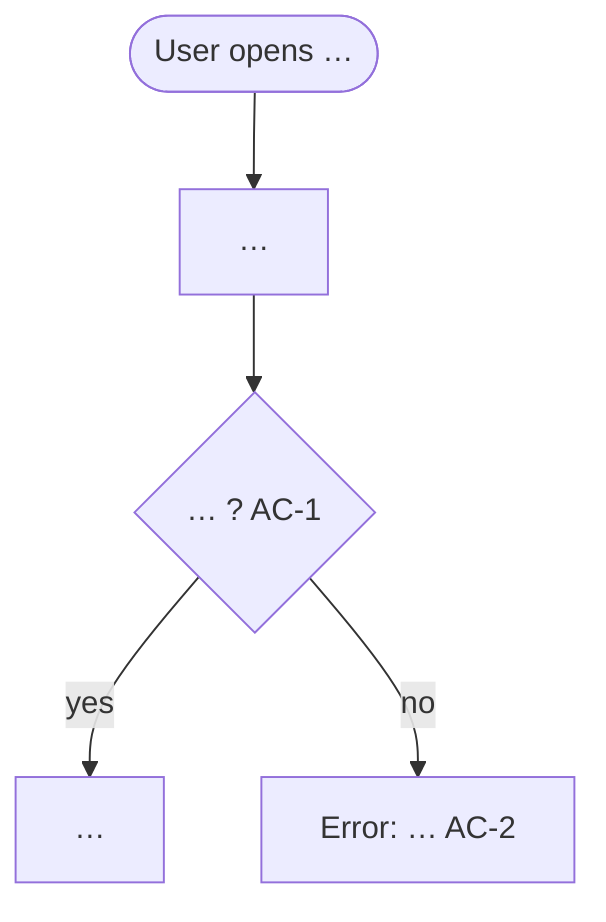

# <ID>: <Feature title>

| Field | Value |
|---|---|
| Status | Draft / Approved (<date>, <who>) |
| Source | <ticket link or "verbal request, <date>"> |
| Profile | web / mobile / backend |

## 1. Problem and goal
<!-- Who has what problem today; what changes for them when this ships. 3–5 sentences. -->

## 2. Users and scenarios
<!-- Personas / roles and the 1–3 main scenarios in plain steps. -->

## 3. Functional requirements
- **FR-1** The system shall …
- **FR-2** When …, the system shall …

## 4. Acceptance criteria
- **AC-1** (FR-1)
  - Given …
  - When …
  - Then …
- **AC-2** (FR-2) …

## 5. Non-functional requirements
- **NFR-1** Performance: …
- **NFR-2** Accessibility: …

## 6. Out of scope
- …

## 7. Decisions
| # | Decision | Source (human / default (unattended)) | Date |
|---|---|---|---|

## 8. Open questions
- **Q1** … — recommended default: …

## 9. How it works
### Flow

<!-- Add "### Sequence" (sequenceDiagram) and "### State" (stateDiagram-v2) when they apply. -->
